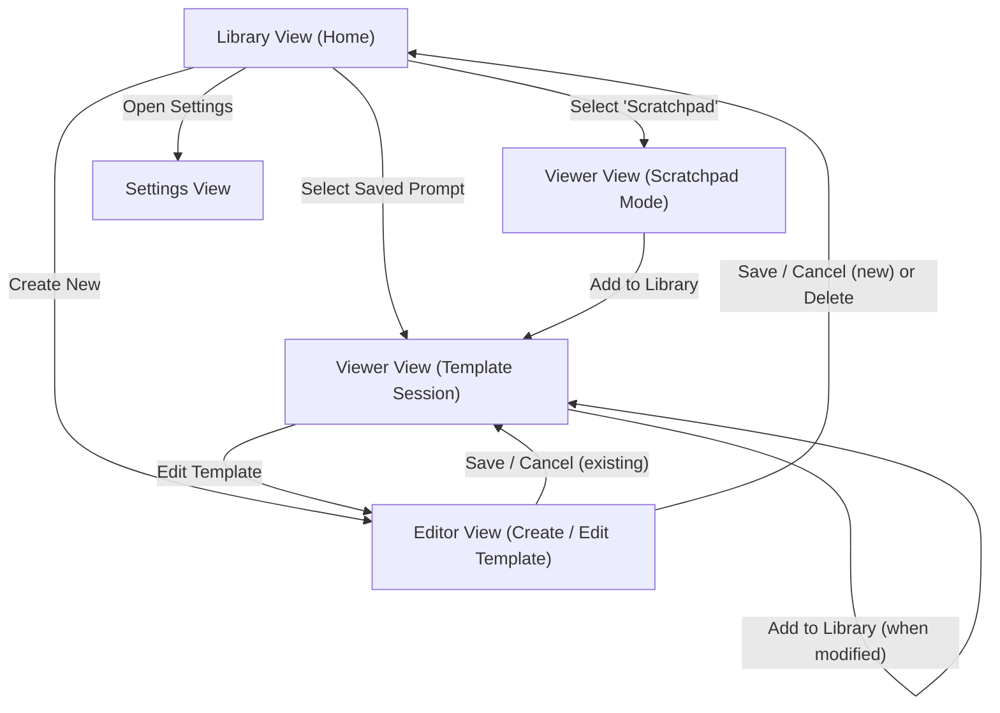

# Promptly — Project Breakdown & Functional Specification (for Rust + GPUI-Kit Port)

## 1. Purpose & Core Concept

**Promptly** is a desktop prompt-engineering tool and template library. It solves the problem of assembling structured, repeatable, multi-part prompts for LLMs without manually copying, pasting, and reformatting Markdown boilerplate every time.

The workflow is split into two primary modes:
1. **Template Authoring (Editor):** Users construct reusable prompt templates out of modular **Blocks (Parts)**—such as static instructions, conditional headings, fillable inputs, code blocks, quotes, dividers, and repeatable sub-templates.
2. **Prompt Assembly (Viewer & Scratchpad):** Users open a saved template (or a blank **Scratchpad**) to fill in dynamic fields, duplicate repeatable sections as needed, reorder or omit blocks for the current session, add ad-hoc blocks on the fly, and copy the compiled, sanitized Markdown output to the system clipboard.

---

## 2. Current Codebase Structure

The existing project is a TypeScript + React + Electron application structured around an IPC boundary between disk persistence and UI state:

```text
promptly/
├── assets/                          # Application icons (.icns, .ico) and branding
├── docs/
│   └── ARCHITECTURE.md              # High-level overview of the Electron app
├── src/
│   ├── types/
│   │   └── index.ts                 # Core data models (Prompt, PromptPart union types)
│   ├── main/
│   │   ├── index.ts                 # Electron main process, window setup, JSON disk I/O handlers
│   │   └── preload.ts               # ContextBridge exposing electronAPI to the renderer
│   └── renderer/
│       ├── App.tsx                  # Root layout (titlebar, scrollable content area, footer) & Router
│       ├── index.css                # Global styles, drag regions, text selection rules
│       └── components/
│           ├── Library.tsx          # Home screen: prompt grid, drag-to-reorder, JSON import modal
│           ├── Editor.tsx           # Template builder: metadata inputs, block list, JSON export
│           ├── Viewer.tsx           # Session workspace: fillable blocks, repeatables, copy pipeline
│           └── Settings.tsx         # Global settings (URL sanitization domain blacklist)
```

> **Porting Note for Rust + GPUI-Kit:** In a native Rust application, the Electron Main/Renderer split and IPC layer (`preload.ts` / `ipcMain`) are unnecessary. The architecture naturally separates into:
> - **Domain & Data Model** (`serde`-serializable structs/enums for `Prompt`, `PromptPart`, `Settings`)
> - **Storage Service** (filesystem read/write in the OS user data directory)
> - **Prompt Compiler & Text Utilities** (Markdown assembly, indentation normalizer, URL sanitizer)
> - **GPUI Views & Reusable Components** (`LibraryView`, `EditorView`, `ViewerView`, `SettingsView`, and block components)

---

## 3. Data Model & Persistence

### 3.1 Core Data Types

In Rust, `PromptPart` maps cleanly to a tagged enum (`#[serde(tag = "type", rename_all = "lowercase")]`), where every part retains a unique `id: String` (used for list identity, drag-and-drop ordering, and session value keying).

#### `Prompt`
| Field | Type | Description |
| :--- | :--- | :--- |
| `id` | `String` | Unique identifier (also used as the filename `<id>.json`). |
| `title` | `String` | Display name of the template (required). |
| `description` | `String` | Short summary shown in the Library view. |
| `createdAt` | `u64` / `i64` | Creation timestamp in milliseconds since Unix epoch. |
| `parts` | `Vec<PromptPart>` | Ordered sequence of blocks making up the template. |

#### `PromptPart` Variants (The 7 Block Types)
| Variant (`type`) | Template Fields | Role in Template |
| :--- | :--- | :--- |
| **`fixed`** | `id: String`<br>`text: String` | Static boilerplate text defined by the template author. Read-only in the Viewer. |
| **`heading`** | `id: String`<br>`text: String`<br>`level: u8` (`1`, `2`, or `3`)<br>`excludeIfNextEmpty: Option<bool>` | Static Markdown heading (`#`, `##`, `###`). Can be configured to automatically omit itself from output if the immediately following block produces empty text. |
| **`custom`** | `id: String`<br>`defaultText: Option<String>`<br>`placeholder: Option<String>`<br>`singleLine: Option<bool>` | A user-fillable text input in the Viewer. Can be a single-line input or multi-line text area, pre-filled with `defaultText`. |
| **`quote`** | `id: String` | A user-fillable multi-line text input in the Viewer whose lines are automatically prefixed with `> ` in the final Markdown output. |
| **`code`** | `id: String`<br>`language: Option<String>` | A user-fillable code editor/input in the Viewer. Defines a default syntax/fence language tag that can be overridden per session in the Viewer. |
| **`hr`** | `id: String` | A structural horizontal rule divider (`---`). |
| **`repeatable`** | `id: String`<br>`templateParts: Vec<PromptPart>` | A container holding a sequence of child `PromptPart`s. In the Viewer, the user can spawn multiple instances of this child sequence. |

### 3.2 Disk Storage & Ordering Logic

All application data is persisted as JSON files inside the OS user-data directory:

1. **Prompt Files (`prompts/<id>.json`):**
   - Each prompt is stored in its own JSON file.
2. **Custom Library Ordering (`prompts/order.json`):**
   - Contains a JSON array of prompt IDs (`["id1", "id2", ...]`).
   - **Sorting Rules when loading the Library:**
     - If both prompts appear in `order.json`, sort by their index in `order.json`.
     - If only one prompt appears in `order.json`, the ordered prompt comes first.
     - If neither appears in `order.json` (e.g., newly created or imported prompts), sort descending by `createdAt` (newest first).
   - Deleting a prompt deletes `prompts/<id>.json` and removes its ID from `prompts/order.json`.
3. **Application Settings (`settings.json`):**
   - Stores `{ "disallowedDomains": "example.com\ninternal.corp" }`.

---

## 4. Application Views & UI Structure

Rather than prescribing specific visual styling, this section documents the **functional layout, component responsibilities, and interactive flows** that the GPUI-Kit UI should support.



### 4.1 Application Shell
- **Window Header / Titlebar:** Custom window drag region displaying the application title/branding.
- **Main Content Area:** Scrollable viewport hosting the active view (`Library`, `Editor`, `Viewer`, or `Settings`).
- **Footer:** Compact status/footer bar displaying the current application version.
- **Selection Behavior:** UI chrome and labels are non-selectable so the app feels native; text selection is enabled only inside text inputs, code blocks, and static `fixed` prompt text.

---

### 4.2 Library View (Home)

The entry point for browsing, organizing, and importing templates.

- **Header Actions:**
  - **Settings:** Navigates to the Settings view.
  - **Import:** Opens a modal/dialog to paste a raw JSON prompt definition.
  - **Create:** Navigates to the Editor view in creation mode.
- **Prompt Collection (Grid/List):**
  - **Scratchpad Item (Pinned):** Always appears first. Represents a blank, temporary workspace (`id = "scratchpad"`). It is not draggable/reorderable.
  - **Saved Prompt Items:** Each displays the prompt's `title`, `description` (truncated), creation date, and total top-level part count (`parts.length`).
    - **Interaction:** Clicking an item opens it in the **Viewer**.
    - **Reordering:** Dragging and dropping items reorders the collection and immediately writes the updated ID list to `order.json`.
- **Empty State:** Shown when no saved templates exist yet, prompting the user to create one.
- **JSON Import Validation & Normalization:**
  - Parses pasted JSON and verifies it is an object with a non-empty `title: String` and `parts: Array`.
  - Recursively validates every part's `type` against the 7 allowed types and normalizes optional/default fields.
  - Generates a fresh `id` for any part missing one, and generates a new prompt `id` if the imported `id` is missing or collides with an existing prompt in the Library.

---

### 4.3 Editor View (Template Builder)

Used to define the structure and default configuration of a `Prompt`. Can be opened in **Create Mode** (blank) or **Edit Mode** (loaded from `<id>.json`).

- **Persistent Top Action Bar:**
  - **Back / Cancel:** Returns to the Viewer (if editing an existing prompt) or the Library (if creating a new one) without saving.
  - **Export (Edit Mode only):** Opens a modal displaying the serialized JSON of the current editor state with a one-click **Copy to Clipboard** button.
  - **Delete (Edit Mode only):** Two-step confirmation button. First click transitions the button to `"Confirm Delete"` (auto-resets after 3 seconds if not clicked); second click deletes the prompt from disk and returns to the Library.
  - **Save Prompt:** Validates that `title` is non-empty, writes the prompt to disk, and navigates to the Viewer (if editing) or Library (if creating).
- **Template Metadata Section:**
  - **Title Input:** Single-line text field.
  - **Description Input:** Multi-line text field.
- **Block List (Parts Editor):**
  - Displays an ordered, vertically reorderable list of blocks.
  - **Common Block Chrome (in Editor):**
    - **Drag Handle:** Reorders the block within its parent list (either the top-level list or a `repeatable` container's child list).
    - **Type Indicator:** Badge/label showing the block type (`HEADING`, `FIXED`, `CUSTOM`, `QUOTE`, `CODE`, `HR`, `REPEATABLE`), visually distinguishing top-level blocks from nested child blocks.
    - **Remove Button:** Deletes the block from the template.
  - **Block-Specific Configuration Controls (in Editor):**
    - **`heading`:**
      - Level selector (`H1`, `H2`, `H3`).
      - Text input for the heading title.
      - Checkbox toggle: *"Exclude if next part is empty"*.
    - **`fixed`:**
      - Multi-line text input for the static text content.
    - **`custom`:**
      - Text input for `Default Text`.
      - Text input for `Placeholder`.
      - Checkbox toggle: *"Single line"* (determines whether the Viewer renders a single-line input or multi-line text area).
    - **`code`:**
      - Dropdown selector for the default fence `Language` (`None`, `csharp`, `typescript`, `javascript`, `python`, `sql`, `json`, `bash`, `powershell`, `html`, `xml`, `yaml`, `markdown`, `diff`). *Note: Code content is entered in the Viewer, not the Editor.*
    - **`quote` & `hr`:**
      - Display a simple read-only descriptor (no template-level parameters to configure).
    - **`repeatable`:**
      - Renders an nested sub-list of `templateParts` that are independently sortable via drag-and-drop.
      - Includes an inline **"Add Child Part"** bar allowing the user to append `heading`, `fixed`, `custom`, `quote`, `code`, or `hr` blocks inside the repeatable template. *(Note: The Editor UI only exposes adding non-repeatable blocks inside a repeatable block, limiting authoring to 1 level of nesting).*
- **Add Top-Level Block Bar:**
  - Located at the bottom of the Editor; provides buttons to append any of the 7 block types to the root `parts` list.

---

### 4.4 Viewer View & Scratchpad (Session Workspace)

The primary workspace where prompts are filled out and compiled. Both saved prompts (`/viewer/:id`) and the **Scratchpad** (`/viewer/scratchpad`) use this exact same view and component logic—the Scratchpad simply starts with an empty `parts` list.

#### Persistent Top Action Bar
- **Back to Library:** Navigates back to the Library.
- **Prompt Title:** Displays the active prompt's title (or `"Scratchpad"`).
- **Add to Library:**
  - Enabled whenever the user has added one or more **Temporary Sections** during the session.
  - Opens a dialog prompting for a new `Title` (pre-filled with `"<Original Title> (Copy)"` or blank for Scratchpad) and `Description`.
  - Converts all current session blocks (including temporary sections and any user-entered text in `custom` fields as the new `defaultText`) into a new saved `Prompt` on disk, then transitions the Viewer to the newly saved prompt **without losing any current input values, selected languages, or repeatable instances**.
- **Edit (Saved Prompts only):** Navigates to the Editor for this template.

#### Session State Architecture (Composite Keying)
Because `repeatable` blocks can be instantiated multiple times at runtime, the Viewer decouples the **structural block list** from the **input value state** using flat lookup maps keyed by a `composite_id`:
- For top-level blocks: `composite_id = part.id`
- For child blocks inside a repeatable instance: `composite_id = "{parent_part_id}_{instance_id}_{child_part_id}"`

The Viewer maintains five pieces of session state:
1. **`session_parts: Vec<PromptPart>`** — Cloned from the template's `parts` on load. Mutated when the user reorders blocks, deletes blocks for the session, or appends temporary blocks.
2. **`values: HashMap<CompositeId, String>`** — Current user-typed text for `custom`, `quote`, and `code` blocks (initialized from `defaultText` for `custom` blocks, and `""` for others).
3. **`languages: HashMap<CompositeId, String>`** — Active language tag for each `code` block instance (initialized from `part.language`).
4. **`raw_values: HashMap<CompositeId, String>`** — Stores the pre-normalized text of a `code` block whenever indentation fixing has been applied, allowing one-click undo.
5. **`repeatable_instances: HashMap<PartId, Vec<InstanceId>>`** — Tracks the active instance IDs for each `repeatable` block (initialized with 1 instance ID on load).

#### Block Rendering & Behavior in the Viewer
Every top-level block has a minimal header with a **drag handle** (to reorder blocks for this session), a subtle **type badge**, and a **hover-revealed delete button** (to omit the block from this session). Child blocks inside a repeatable instance omit the drag handle and delete button.

| Block Type | Viewer Behavior & Controls |
| :--- | :--- |
| **`heading`** | Renders as a static visual heading (`H1` / `H2` / `H3`). |
| **`fixed`** | Renders as a read-only, selectable text container with preserved line breaks (`pre-wrap`). |
| **`custom`** | Renders either a single-line text input (`singleLine == true`) or a multi-line text area (`singleLine == false`), bound to `values[composite_id]`. |
| **`quote`** | Renders a multi-line text area (styled as a blockquote with a left border and italic text), bound to `values[composite_id]`. |
| **`code`** | Renders a monospace multi-line code editor/textarea bound to `values[composite_id]`, plus a footer bar with:<br>1. **Language Selector:** Overrides `languages[composite_id]` for this session.<br>2. **Smart Paste & Indentation Fixer:** Automatically normalizes indentation on paste (and via a manual **"Fix Indentation"** button), with a **"Reset Indentation"** undo button if modified (see Section 5.2). |
| **`hr`** | Renders a visual horizontal separator line. |
| **`repeatable`** | Renders a grouped container listing each active instance (`Instance #1`, `Instance #2`, ...):<br>• Each instance card renders all child `templateParts` bound to their `{parent_id}_{instance_id}_{child_id}` keys.<br>• Each instance has a **Remove Instance** button (disabled if only 1 instance remains).<br>• An **"Add another instance"** button at the bottom appends a new instance ID and initializes its child values/languages. |

#### Session Mutability (Temporary Sections)
At the bottom of the Viewer block list, an **"Add temporary section"** bar lets the user append ad-hoc blocks (`Custom Input`, `Quote`, `Code Block`, `Rule`) directly into `session_parts` (prefixed with `session_`). These behave identically to template blocks for reordering, editing, and output compilation, and enable the **"Add to Library"** promotion flow.

---

### 4.5 Settings View

A focused configuration screen accessible from the Library:
- **Disallowed Domains (`disallowedDomains`):** A multi-line monospace text input where users enter one domain per line (e.g., `example.com`, `internal.site`).
- **Save Action:** Writes the updated settings to `settings.json` and shows a brief confirmation state.

---

## 5. Core Domain Logic & Algorithms

### 5.1 Prompt Compilation Pipeline

When the user triggers **Copy Completed Prompt** in the Viewer, the app compiles `session_parts` into a single Markdown string:

1. **First Pass — Block Evaluation (`generatePartText`):**
   - `heading` $\rightarrow$ `"#".repeat(level) + " " + text`
   - `fixed` $\rightarrow$ `part.text`
   - `custom` $\rightarrow$ `values[composite_id]` (or `""`)
   - `quote` $\rightarrow$ If `values[composite_id]` is non-empty, prefixes every line with `"> "`; otherwise `""`.
   - `code` $\rightarrow$ If `values[composite_id]` is non-empty, wraps in fenced code block: ```` ```{lang}\n{code}\n``` ````; otherwise `""`.
   - `hr` $\rightarrow$ `"---"`
   - `repeatable` $\rightarrow$ For each `instance_id` in `repeatable_instances[part.id]`:
     - Evaluates all `templateParts` for that instance (First Pass).
     - Applies the Conditional Heading Exclusion pass (Second Pass) within that instance's parts.
     - Filters out empty strings (`""`) and joins the instance's parts with `"\n\n"`.
     - Filters out empty instances and joins all instances with `"\n\n"`.
2. **Second Pass — Conditional Heading Exclusion (`excludeIfNextEmpty`):**
   - Iterates through the evaluated strings of the part list.
   - If part `i` is a `heading` with `excludeIfNextEmpty == true`, it inspects the generated string at `i + 1`.
   - If `texts.get(i + 1)` is `None` or whitespace-only (`trim().is_empty()`), part `i`'s output is replaced with `""`.
3. **Final Join:**
   - Filters out all empty strings (`text != ""`) and joins the remaining sections with double newlines (`"\n\n"`).
4. **URL Sanitization:**
   - Runs `stripDisallowedUrls` on the compiled string before writing it to the system clipboard.

### 5.2 Smart Code Indentation Normalization (`getFixedIndentation`)

When copying a snippet from an IDE from the middle of a line (e.g. starting selection right at `function foo()`), the first line has `0` leading spaces while all subsequent lines carry the indentation of the surrounding class/module (e.g., 8 spaces). Standard dedent algorithms fail if they include line 1's `0` indent when computing the minimum indentation.

Promptly handles this specifically:
1. Split text into `lines`.
2. Check if `lines[0]` starts with whitespace (`hasFirstLineIndent`).
3. Determine the candidate lines for finding `minIndent`:
   - If `hasFirstLineIndent` is `true` (or there is only 1 line), inspect **all** lines.
   - If `hasFirstLineIndent` is `false` and `lines.len() > 1`, inspect **`lines[1..]`** (ignoring the unindented first line).
4. Compute `minIndent`: the minimum count of leading whitespace characters across all non-empty candidate lines.
5. If `minIndent > 0` and at least one indented line was found:
   - Leave `lines[0]` untouched if `!hasFirstLineIndent && lines.len() > 1`.
   - Convert whitespace-only lines to `""`.
   - Strip `minIndent` characters from the start of all other lines.
6. **Paste & Undo Integration:**
   - When pasting into a `code` block, if `getFixedIndentation(pasted)` differs from `pasted`, the normalized text is inserted at the cursor selection while the un-normalized result is saved in `raw_values[composite_id]`.
   - While `raw_values[composite_id]` is present, the UI swaps the **"Fix Indentation"** action for **"Reset Indentation"**, allowing the user to revert to the exact raw whitespace if desired.

### 5.3 URL Sanitization (`stripDisallowedUrls`)

To prevent leaking internal hostnames or confidential URLs when pasting prompts into external LLMs:
- Configured via the newline-separated domain list in Settings.
- Matches both:
  1. **Markdown links:** `[anchor text](url)` $\rightarrow$ replaced with `[anchor text]()` if disallowed.
  2. **HTML `href` attributes:** `href="url"` or `href='url'` $\rightarrow$ replaced with `href=""` or `href=''` if disallowed.
- **Domain Matching Rule:** Parses `url` and extracts `hostname` (lowercased). A URL is stripped if `hostname == domain` or `hostname.ends_with(&format!(".{domain}"))`. Invalid/relative URLs that fail URL parsing are left untouched.

---

## 6. Considerations for the Rust + GPUI-Kit Architecture

When designing the new GPUI-Kit component hierarchy, we can preserve all of the functional capabilities above while making the component model significantly cleaner:

1. **Unified Block Trait / Enum Dispatch:**
   - In the current React codebase, `EditorPart` and `ViewerPart` are large monolithic components with conditional branches for every part type.
   - In Rust + GPUI-Kit, each block variant (`Heading`, `Fixed`, `Custom`, `Quote`, `Code`, `Hr`, `Repeatable`) can have dedicated, self-contained Editor and Viewer sub-components (or view models) wrapped by a shared `BlockFrame` component that handles drag handles, badges, and deletion actions.
2. **Hierarchical vs. Composite State in GPUI:**
   - The React app used string-concatenated composite keys (`parentId_instanceId_childId`) to avoid deep React state updates.
   - In GPUI, you can either keep a clean typed composite key struct `(PartId, Option<(InstanceId, PartId)>)` or model each active session block/instance as its own GPUI `Entity<SessionBlockState>` / model handle, which makes input focus, text buffers, undo history, and drag-and-drop reordering much more ergonomic and idiomatic in Rust.
3. **JSON Compatibility:**
   - Using `serde` with `#[serde(rename_all = "camelCase")]` on `Prompt` and `#[serde(tag = "type", rename_all = "lowercase")]` on `PromptPart` will maintain **100% backward compatibility** with existing `prompts/*.json` files, `order.json`, `settings.json`, and the Import/Export JSON format.
