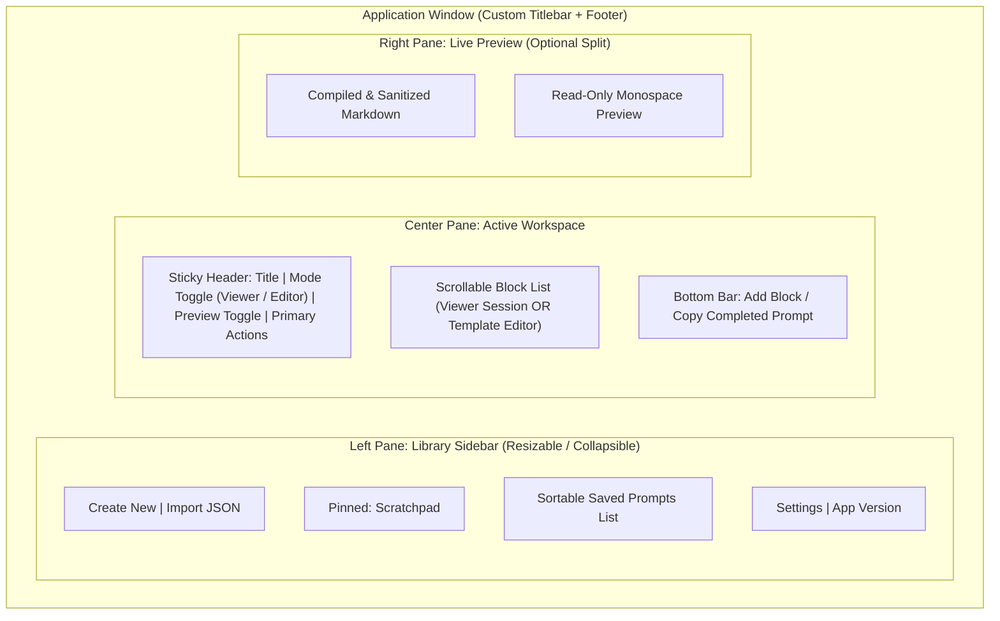

# Phased Implementation Plan: Porting Promptly to Rust + GPUI-Kit

This document provides a step-by-step implementation plan for an AI agent (or developer) to build the native Rust + **GPUI-Kit** (`gpui` + `gpui-component`) port of **Promptly** in a new repository.

## Architectural Decisions Incorporated
1. **Standalone Rust Repository:** The port will be built as a fresh Cargo project outside the Electron codebase.
2. **100% File & Schema Compatibility + Data Directory Migration:** The Rust port uses the exact same JSON schema (`prompts/<id>.json`, `prompts/order.json`, `settings.json`) and includes an automatic, non-destructive migration utility to copy existing templates and settings from the legacy Electron app data directory into the new app's data directory.
3. **Multi-Pane Desktop Layout:** Instead of full-window page swaps, the UI adopts a multi-pane desktop layout (persistent collapsible **Library Sidebar** + **Main Workspace Pane** switching cleanly between Viewer and Editor modes + toggleable **Live Markdown Preview Pane**).
4. **Modular Block Components:** Replaces monolithic switch-case rendering with a shared `BlockFrame` wrapper and dedicated per-block-type components.

---

## Target Project Structure

```text
promptly-rs/
├── Cargo.toml
├── assets/
│   ├── icon.icns
│   ├── icon.ico
│   └── logo-full.png
└── src/
    ├── main.rs                  # GPUI app entry point, window setup, gpui_component::init
    ├── app.rs                   # Root AppShell entity, multi-pane layout, global state
    ├── model/
    │   ├── mod.rs
    │   ├── prompt.rs            # Prompt, PromptPart enum, Language enum, JSON validation
    │   ├── settings.rs          # AppSettings (disallowedDomains, migration status, UI prefs)
    │   └── session.rs           # ViewerSession state, RepeatableInstance, CodeBlockState
    ├── services/
    │   ├── mod.rs
    │   ├── storage.rs           # Disk I/O, order.json sorting, legacy Electron migration
    │   ├── compiler.rs          # 2-pass Markdown prompt compiler
    │   ├── indentation.rs       # Smart IDE paste dedent & undo logic
    │   └── sanitizer.rs         # Markdown & HTML URL domain stripper
    └── ui/
        ├── mod.rs
        ├── sidebar.rs           # Persistent Library sidebar (Scratchpad + sortable prompts)
        ├── modals/
        │   ├── mod.rs
        │   ├── import_modal.rs  # JSON paste, validation & normalization dialog
        │   ├── export_modal.rs  # Read-only JSON viewer & clipboard copy dialog
        │   ├── save_modal.rs    # "Add to Library" promotion dialog
        │   └── settings_modal.rs# Disallowed domains editor & manual migration trigger
        ├── workspace/
        │   ├── mod.rs           # Workspace container & header toolbar (Viewer <-> Editor)
        │   ├── viewer.rs        # Session assembly view & temporary section bar
        │   ├── editor.rs        # Template builder view & 2-step delete confirmation
        │   └── preview.rs       # Optional split-pane live Markdown output preview
        └── blocks/
            ├── mod.rs
            ├── frame.rs         # Shared BlockFrame (drag handle, type badge, remove button)
            ├── heading.rs       # HeadingPart editor & viewer rendering
            ├── fixed.rs         # FixedPart editor & viewer rendering
            ├── custom.rs        # CustomPart editor & viewer rendering
            ├── quote.rs         # QuotePart editor & viewer rendering
            ├── code.rs          # CodePart editor & viewer rendering (paste/indent/lang)
            ├── hr.rs            # HRPart editor & viewer rendering
            └── repeatable.rs    # RepeatablePart nested editor & multi-instance viewer
```

---

## Multi-Pane Layout Architecture



---

## Phase 1: Project Scaffolding, Data Models & Core Domain Services

### Objective
Establish the Cargo project, define `serde` data models that are 100% wire-compatible with existing Promptly JSON files, and implement all pure text-processing and compilation algorithms with comprehensive unit tests before touching UI code.

### Tasks
1. **Initialize Cargo Project & Dependencies:**
   - Add core crates: `serde` (with `derive`), `serde_json`, `regex`, `url`, `dirs` (or `directories`), `uuid` / `rand`, `anyhow`, `thiserror`.
   - Add UI crates: `gpui`, `gpui-component` (from `gpui-kit`).
2. **Implement Data Models (`src/model/prompt.rs` & `src/model/settings.rs`):**
   - Define `Prompt`:
     ```rust
     #[derive(Debug, Clone, Serialize, Deserialize, PartialEq)]
     #[serde(rename_all = "camelCase")]
     pub struct Prompt {
         pub id: String,
         pub title: String,
         #[serde(default)]
         pub description: String,
         pub created_at: u64,
         pub parts: Vec<PromptPart>,
     }
     ```
   - Define `PromptPart` using `#[serde(tag = "type", rename_all = "lowercase")]`:
     - `Fixed { id: String, #[serde(default)] text: String }`
     - `Heading { id: String, #[serde(default)] text: String, #[serde(default = "default_level")] level: u8, #[serde(rename = "excludeIfNextEmpty", default, skip_serializing_if = "Option::is_none")] exclude_if_next_empty: Option<bool> }`
     - `Custom { id: String, #[serde(rename = "defaultText", default)] default_text: Option<String>, #[serde(default)] placeholder: Option<String>, #[serde(rename = "singleLine", default)] single_line: Option<bool> }`
     - `Quote { id: String }`
     - `Code { id: String, #[serde(default)] language: Option<String> }`
     - `Hr { id: String }`
     - `Repeatable { id: String, #[serde(rename = "templateParts")] template_parts: Vec<PromptPart> }`
   - Implement `import_and_normalize_prompt(raw_json: &str, existing_ids: &HashSet<String>) -> Result<Prompt>` matching the exact validation rules in the original `Library.tsx` (checking required `title` and `parts`, validating part types, generating missing IDs, and resolving ID collisions).
3. **Implement Prompt Compiler (`src/services/compiler.rs`):**
   - Implement two-pass compilation over top-level parts and nested repeatable instances:
     - **Pass 1:** Evaluate each block (`#` prefix for headings, `> ` prefix per line for non-empty quotes, ```` ```lang\ncode\n``` ```` for non-empty code blocks, `---` for `hr`, recursive instance evaluation for `repeatable`).
     - **Pass 2:** For any `Heading` where `exclude_if_next_empty == Some(true)`, inspect `evaluated_texts.get(i + 1)`. If `None` or `trim().is_empty()`, replace the heading's output with `""`.
     - **Join:** Filter out `""` and join with `"\n\n"`.
4. **Implement Smart Indentation Fixer (`src/services/indentation.rs`):**
   - Port `fix_indentation(text: &str) -> String`:
     - If line 0 has no leading whitespace and there are multiple lines, compute `min_indent` across non-empty lines in `lines[1..]`; otherwise compute across all non-empty lines.
     - Strip `min_indent` leading characters from indented lines and normalize whitespace-only lines to `""`.
5. **Implement URL Sanitizer (`src/services/sanitizer.rs`):**
   - Port `strip_disallowed_urls(text: &str, disallowed_domains: &[String]) -> String`:
     - Match Markdown links `[text](url)` and HTML attributes `href="url"` / `href='url'`.
     - Parse URLs with the `url` crate; if `host_str` matches `domain` or ends with `.{domain}` (case-insensitive), strip the URL while preserving `[text]()` or `href=""`.

### Verification Criteria
- `cargo test` passes unit tests covering:
  - Round-trip serialization/deserialization of real Promptly `.json` files.
  - Import normalization (missing part IDs, invalid part types rejected, colliding prompt IDs regenerated).
  - Conditional heading exclusion (both top-level and inside repeatable instances).
  - Indentation fixing (standard indented blocks, IDE copy with unindented first line, single-line no-op).
  - URL sanitization (exact domain match, subdomain match, non-matching domain preserved, relative URLs untouched).

---

## Phase 2: Storage Layer & Legacy Data Migration

### Objective
Implement filesystem persistence for prompts, custom ordering, settings, and automatic/manual migration from the legacy Electron app data directory.

### Tasks
1. **Directory Resolution (`src/services/storage.rs`):**
   - Resolve the new app's data directory (e.g., `<OS AppData>/Promptly-RS` or configurable path) and detect the legacy Electron directory (`<OS AppData>/Promptly` and `<OS AppData>/promptly`).
     - macOS: `~/Library/Application Support/Promptly`
     - Windows: `%APPDATA%\Promptly`
     - Linux: `~/.config/Promptly`
2. **Legacy Migration Routine:**
   - On startup, check if the new data directory has been initialized (e.g., via a `.migrated` marker or existing `prompts/` directory).
   - If uninitialized and a legacy Electron `Promptly` directory exists:
     - Copy `settings.json`, `prompts/order.json`, and all `prompts/*.json` files into the new data directory (non-destructively leaving the original Electron files intact).
   - Also expose a public `migrate_from_directory(source_dir: &Path)` method so the user can manually trigger migration or import from a folder in Settings.
3. **CRUD & Ordering Operations:**
   - `load_prompts() -> Result<Vec<Prompt>>`: Reads all `prompts/*.json` (excluding `order.json`) and sorts them using `order.json`:
     - Both in `order.json` $\rightarrow$ sort by index in `order.json`.
     - Only one in `order.json` $\rightarrow$ ordered item first.
     - Neither in `order.json` $\rightarrow$ sort by `created_at` descending.
   - `save_prompt(&Prompt)`: Atomic write to `prompts/<id>.json`.
   - `delete_prompt(id: &str)`: Removes `prompts/<id>.json` and filters `id` out of `prompts/order.json`.
   - `save_prompts_order(ids: &[String])`: Writes `prompts/order.json`.
   - `load_settings()` / `save_settings(&AppSettings)`: Reads/writes `settings.json`.

### Verification Criteria
- Integration tests using `tempfile::tempdir()` verify:
  - Legacy Electron directory is automatically copied on first run and not overwritten on subsequent runs.
  - Prompt sorting matches `order.json` priority + `created_at` fallback.
  - Deleting a prompt removes both its `.json` file and its entry in `order.json`.

---

## Phase 3: GPUI-Kit App Shell, Multi-Pane Layout & Library Sidebar

### Objective
Bring up the native GPUI window with `gpui-component`, build the multi-pane layout (`LibrarySidebar` + `WorkspacePane`), and wire up prompt browsing and drag-and-drop reordering in the sidebar.

### Tasks
1. **Window & Theme Initialization (`src/main.rs`):**
   - Configure `WindowOptions` with default size `1366x768`, custom titlebar / traffic-light positioning, and initialize `gpui_component::init(cx)`.
   - Render custom titlebar drag region and global footer displaying `env!("CARGO_PKG_VERSION")`.
2. **App State & Multi-Pane Shell (`src/app.rs`):**
   - Create root `AppShell` entity holding:
     - `prompts: Vec<Prompt>`
     - `active_target: WorkspaceTarget` (`Scratchpad`, `SavedPrompt(String)`, or `NewPrompt`)
     - `workspace_mode: WorkspaceMode` (`Viewer` or `Editor`)
     - `show_live_preview: bool`
     - `sessions: HashMap<String, Entity<ViewerSession>>` (caches active Viewer inputs per prompt ID and for `"scratchpad"` so switching items in the sidebar never loses in-progress work).
   - Use GPUI-Kit's `Resizable` / split-pane layout to host `LibrarySidebar` on the left and `WorkspacePane` in the center (plus optional `LivePreviewPane` on the right).
3. **Library Sidebar (`src/ui/sidebar.rs`):**
   - Top action buttons: **Create (`+`)** and **Import**.
   - Search/filter input to quickly filter sidebar prompts by title/description.
   - Pinned **Scratchpad** item at the top of the list.
   - Sortable list of saved prompts showing `title`, truncated `description`, and part count badge.
   - Drag-and-drop reordering of saved prompts that updates `self.prompts` and calls `storage.save_prompts_order(...)`.
   - Sidebar footer with **Settings** button and version label.

### Verification Criteria
- Application launches into the multi-pane layout and displays migrated/saved prompts in the left sidebar.
- Clicking `Scratchpad` or any saved prompt updates the active workspace target.
- Dragging prompts in the sidebar reorders them and persists the new order to `prompts/order.json`.

---

## Phase 4: Modular Block Components & Template Editor Mode

### Objective
Implement the reusable `BlockFrame` wrapper, the Editor UI for all 7 block types (including nested `Repeatable` templates), and the `PromptEditor` workspace view.

### Tasks
1. **Shared Block Frame (`src/ui/blocks/frame.rs`):**
   - Build a clean container component accepting:
     - Drag handle attributes/listeners
     - Block type badge (`HEADING`, `FIXED`, `CUSTOM`, `QUOTE`, `CODE`, `HR`, `REPEATABLE`) with distinct visual styling for top-level vs. nested child blocks
     - Delete/remove action callback
     - Child content slot
2. **Per-Block Editor Components (`src/ui/blocks/*.rs`):**
   - `Heading`: Level selector (`H1`, `H2`, `H3`), title `Input`, and `"Exclude if next part is empty"` checkbox.
   - `Fixed`: Multi-line `Input` for static boilerplate text.
   - `Custom`: `Default Text` input, `Placeholder` input, and `"Single line"` checkbox toggle.
   - `Code`: Default language dropdown selector (`None`, `csharp`, `typescript`, `javascript`, `python`, `sql`, `json`, `bash`, `powershell`, `html`, `xml`, `yaml`, `markdown`, `diff`).
   - `Quote` & `Hr`: Compact informational labels.
   - `Repeatable`: Nested vertical sortable list of child `template_parts` + inline toolbar to append child blocks (`Heading`, `Fixed`, `Custom`, `Quote`, `Code`, `Hr`).
3. **Template Editor View (`src/ui/workspace/editor.rs`):**
   - Sticky workspace header with:
     - Mode indicator (`Create New Prompt` or `Edit Prompt`)
     - **Cancel** button (returns to Viewer mode for existing prompt, or Scratchpad if cancelling creation)
     - **Export** button (for existing prompts)
     - **Delete** button with 2-step confirmation (`Delete` $\rightarrow$ `Confirm Delete` with 3-second auto-reset timer via `cx.spawn`)
     - **Save Prompt** button (validates non-empty `title`, persists via `StorageService`, reloads sidebar list, and switches workspace back to `Viewer` mode).
   - Metadata card with `Title` and `Description` inputs.
   - Top-level drag-and-drop sortable block list + bottom **"Add a Part"** toolbar for all 7 block types.

### Verification Criteria
- Can create a new prompt with all 7 block types (including nested parts inside a Repeatable section) and save it to disk.
- Can reorder both top-level blocks and nested repeatable child blocks via drag-and-drop.
- Two-step delete confirmation resets after 3 seconds if unclicked, and deletes the prompt on second click.

---

## Phase 5: Prompt Viewer Mode, Scratchpad, Live Preview & Copy Pipeline

### Objective
Implement the interactive `PromptViewer` workspace, entity-backed session state, repeatable instance expansion, smart code block paste/indentation handling, session-level block mutability, and the clipboard compilation pipeline.

### Tasks
1. **Viewer Session Model (`src/model/session.rs`):**
   - Model each prompt's active session cleanly in GPUI:
     - `session_parts: Vec<PromptPart>` (cloned from template `parts`, allowing session-only reordering, deletion, and appending `session_`-prefixed temporary blocks).
     - `values: HashMap<CompositeKey, String>` (or per-block GPUI `InputState` entities keyed by `CompositeKey`).
     - `languages: HashMap<CompositeKey, String>`
     - `raw_values: HashMap<CompositeKey, String>` (tracks pre-dedented text for code blocks).
     - `repeatable_instances: HashMap<String, Vec<String>>` (ordered instance IDs per repeatable part, initialized with 1 instance).
2. **Per-Block Viewer Components (`src/ui/blocks/*.rs`):**
   - Wrap top-level Viewer blocks in `BlockFrame` (with drag handle, subtle type badge, and hover-revealed remove button). Omit drag/remove chrome for nested child blocks inside repeatable instances.
   - `Heading`: Static visual heading (`H1`/`H2`/`H3`).
   - `Fixed`: Read-only, text-selectable container with `pre-wrap` whitespace.
   - `Custom`: Single-line or multi-line GPUI `Input` initialized with `default_text` and `placeholder`.
   - `Quote`: Multi-line GPUI `Input` with left quote accent border and italic styling.
   - `Code`: Monospace multi-line GPUI `Input` with:
     - Paste handler intercepting clipboard text, running `fix_indentation`, storing original text in `raw_values` if modified, and inserting dedented text.
     - Footer bar with **"Fix Indentation"** / **"Reset Indentation"** toggle button and per-instance **Language Selector** dropdown.
   - `Hr`: Horizontal divider.
   - `Repeatable`: Renders an instance card for each ID in `repeatable_instances[part.id]` (`Instance #1`, `Instance #2`, ...) with a remove button (disabled when `len <= 1`) and an **"Add another instance"** button at the bottom.
3. **Temporary Sections & Session Controls (`src/ui/workspace/viewer.rs`):**
   - Bottom **"Add temporary section"** bar appending `Custom`, `Quote`, `Code`, or `Hr` blocks with `session_` IDs.
   - Header actions:
     - **Reset Session** button (restores `session_parts` and inputs to template defaults).
     - **Add to Library** button (enabled when any `session_` part exists).
     - **Edit Template** button (switches workspace to `Editor` mode for saved prompts).
     - **Toggle Live Preview** button (opens/closes the right-hand `LivePreviewPane`).
4. **Copy & Live Preview Pipeline (`src/ui/workspace/preview.rs`):**
   - Wire `compile_prompt` + `strip_disallowed_urls` to both the optional `LivePreviewPane` and the **"Copy Completed Prompt"** button.
   - Write sanitized output to `cx.write_to_clipboard(...)` and show `"Copied to Clipboard!"` confirmation state for 2 seconds.

### Verification Criteria
- Filling inputs, adding/removing repeatable instances, and toggling conditional headings dynamically updates the compiled output.
- Pasting indented code into a Code Block automatically fixes surplus indentation and exposes `"Reset Indentation"`, which restores the exact raw paste when clicked.
- Reordering or deleting blocks in the Viewer affects the compiled output without altering the saved template on disk.
- Switching between prompts in the sidebar preserves in-progress Viewer session inputs.

---

## Phase 6: Import, Export, "Add to Library" & Settings Modals

### Objective
Complete all modal workflows and global settings configuration.

### Tasks
1. **Import Prompt Modal (`src/ui/modals/import_modal.rs`):**
   - Multi-line monospace JSON input with validation error banner.
   - Runs `import_and_normalize_prompt`, saves the new prompt via `StorageService`, refreshes the sidebar, and selects the newly imported prompt in the Viewer.
2. **Export Prompt Modal (`src/ui/modals/export_modal.rs`):**
   - Displays pretty-printed JSON of the current prompt in the Editor with a one-click **Copy to Clipboard** button and 2-second `"Copied!"` feedback.
3. **"Add to Library" Modal (`src/ui/modals/save_modal.rs`):**
   - Triggered from the Viewer when temporary sections (`session_*`) have been added (either in Scratchpad or a modified template session).
   - Prompts for `Title` (defaults to `""` for Scratchpad or `"<Title> (Copy)"` for saved prompts) and `Description`.
   - Converts `session_` part IDs to permanent `part_` IDs, saves current user-entered `values` of `Custom` parts as their new `default_text`, writes the new prompt to disk, and switches the active workspace to the new prompt **while transferring the current `ViewerSession` state** so no typed inputs or repeatable instances are lost.
4. **Settings Modal / View (`src/ui/modals/settings_modal.rs`):**
   - Multi-line monospace input for **Disallowed Domains** (one domain per line), persisted to `settings.json`.
   - **Legacy Data Migration** section showing the detected legacy Electron data path and a button to manually re-run non-destructive import/migration.

### Verification Criteria
- Exporting a prompt from the Editor and importing that JSON via the Import Modal produces an identical, working template.
- Building an ad-hoc prompt in the Scratchpad and clicking **"Add to Library"** creates a permanent template and keeps all current field values intact in the Viewer.
- Adding a domain (e.g., `internal.corp`) in Settings strips URLs matching `https://internal.corp/...` and `https://sub.internal.corp/...` from Markdown and HTML links upon copying.
